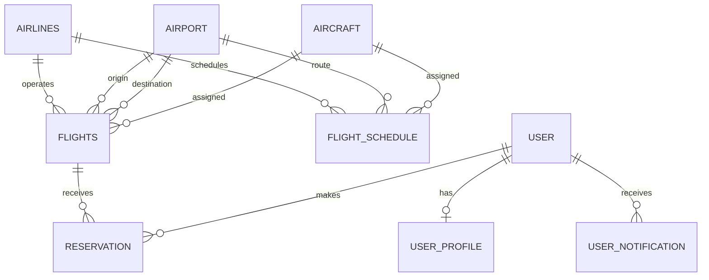

# Django ARMS 2.0: AI-Powered Airline Reservation and Cinematic Travel Management System

ARMS 2.0 is a Django airline reservation and travel-management application. It combines scheduled flight and seat records maintained in ARMS, optional flight-tracking integrations, guest reservation workflows, two-factor authentication, and a multilingual conversational travel assistant. An ARMS reservation is not an airline-issued ticket unless an external booking provider confirms it.

Project demonstration: [YouTube video](https://youtu.be/EJkb_slY4gU?si=LH_LaqsJEbSqSGjS)

## Contents

- [What's New in ARMS 2.0](#whats-new-in-arms-20)
- [Features](#features)
- [How the system works](#how-the-system-works)
- [Technology](#technology)
- [Repository layout](#repository-layout)
- [Run locally](#run-locally)
- [Test and sample data](#test-and-sample-data)
- [Configuration](#configuration)
- [Deployment](#deployment)
- [Security and operational notes](#security-and-operational-notes)

## What's New in ARMS 2.0

- **Dark Cinematic Visual Direction**: Built around an obsidian and champagne-gold palette (`#0b0f17`, `#131924`, `#c5a880`) with responsive navigation and booking entry points.
- **Guest Booking and Management Mode**: Unauthenticated visitors can browse schedules, select seats, complete bookings, receive unguessable references (`GUEST-XXXX-XXXX`), and retrieve or manage their itineraries via the Guest Lookup Portal.
- **Multilingual AI Travel Assistant**: Conversational agent supporting English, Spanish, French, German, Japanese, and Hindi. When a provider is configured, it can use validated, read-only flight-search and fare tools. Reservation lookups remain in the verified portal.
- **Two-Factor Authentication (2FA / OTP)**: Timing-safe one-time passcode verification for passenger and administrator logins with 5-attempt rate-limiting lockout.
- **User Travel Preferences**: Persistent preferences (seat class, language, currency, meal preferences, travel style) for authenticated passengers.
- **Legal and Privacy Drafts**: Terms of Service (`/terms`) and Privacy Policy (`/privacy`) pages are linked from navigation. They are drafts and require operator and legal review before production use.
- **Automated Tests**: Run the current Django suite with `python manage.py test`; it covers authentication, guest reservations, flight tracking, and AI behavior.

## Features

### Passenger features

- Register with a username, a separate User ID, contact details, date of birth, and a password-recovery question.
- Sign in with either the username or User ID. Sessions last 24 hours; signing in on another device does not invalidate an existing device session.
- Search future flights by origin, destination, and travel date; inspect fare, route, airline, and seat availability.
- Select available business- or economy-class seats and submit passenger/contact details.
- Verify a reservation with the account password and CAPTCHA.
- View reservation status, receive in-app notifications, and cancel eligible reservations before departure.
- View a dashboard, profile, upcoming flights, and flight tracking.

### Administrator features

- Maintain airlines, airports, aircraft, flights, and recurring flight schedules.
- Review reservations and approve or reject pending requests.
- Inspect upcoming flights, reservation counts, and seat occupancy.
- Import airline, airport, aircraft, and flight records from CSV files.

### Additional features

- Reservation status notifications and QR-code support in reservation views.
- Flight status lookup with AviationStack when configured, with OpenSky Network used as a fallback source.
- Travel assistant that searches ARMS's own future-flight records and can call OpenRouter, Groq, Hugging Face, or OpenAI when configured. The model can use bounded read-only ARMS search and fare tools. Without credentials or when a provider fails, it uses clearly identified local guidance. Local destination costs are sample estimates, not current market prices.
- CAPTCHA verification on reservation submission and standard Django CSRF protection on form posts.

## How the system works

### Main data concepts

The application uses Django models and relational database constraints to connect operational records:

| Entity | Purpose and relationships |
| --- | --- |
| `Airlines` | Airline code, name, country, active state, and optional logo. |
| `Airport` | Airport code, name, city, country, and active state. |
| `Aircraft` | Aircraft model/manufacturer and business/economy seat capacities. |
| `Flights` | A dated service joining an airline, origin airport, destination airport, and aircraft; stores departure/arrival, fare, currency, and capacity. |
| `FlightSchedule` | A reusable route/aircraft/time definition with a date range and recurrence rule; it can generate dated `Flights`. |
| `User` and `UserProfile` | Django authentication identity plus the ARMS User ID, role, contact information, and recovery details. Each profile belongs to one user. |
| `Reservation` | Passenger and contact information linked to a flight, optional signed-in user, cabin class, seat number, and workflow status. |
| `UserNotification` | In-app messages associated with a user, such as reservation decisions. |



### Reservation lifecycle

The passenger chooses a future flight and available seat, provides passenger details, and passes password/CAPTCHA verification. The resulting record is a reservation request, not a ticket issued by an airline or a payment transaction. Administrators process pending requests:

| Stored status | Meaning |
| --- | --- |
| `0` | Pending administrator approval |
| `1` | Approved/confirmed in this application |
| `2` | Cancelled |
| `3` | Rejected by an administrator |

Seat availability is derived from aircraft capacity and reservation records; cancelled records do not consume a seat. A reservation cannot be cancelled after its flight has departed.

### Request structure

The Django project package (`django_arms/`) owns settings, middleware, and the root URL configuration. The `armsApp` application owns database models, views, forms, templates, admin screens, migrations, and custom management commands. URL patterns dispatch browser requests to views; views validate inputs, read/write models through the Django ORM, and render templates or return JSON for AJAX actions.

## Technology

- Python 3.12 or newer and Django 6.x (the dependency file pins Django 6.0.7).
- SQLite for local development; PostgreSQL through `DATABASE_URL` for a persistent deployment database.
- Django templates, Bootstrap assets, jQuery, DataTables, and Select2 for the web interface.
- WhiteNoise for static files in the deployed Django service.
- `django-simple-captcha`, `django-qr-code`, Pillow, and `requests`/`certifi` for external travel and AI APIs.
- AviationStack and OpenSky Network for optional flight status/position lookups; Leaflet and OpenStreetMap tiles render available map positions.

## Repository layout

```text
.
|-- README.md
|-- DEPLOY_TO_RENDER.md
|-- Procfile
|-- render.yaml
|-- vercel.json
|-- docker/
|   `-- Dockerfile
`-- django_arms/
    |-- manage.py
    |-- requirements.txt
    |-- settings_prod.py              # Legacy/standalone settings file
    |-- django_arms/
    |   |-- settings.py               # Local settings (SQLite)
    |   |-- settings_prod.py          # Importable production settings
    |   |-- urls.py
    |   `-- wsgi.py
    |-- armsApp/
    |   |-- models.py
    |   |-- forms.py
    |   |-- views.py
    |   |-- migrations/
    |   |-- management/commands/
    |   `-- templates/
    |-- static/
    `-- staticfiles/                  # Collected during deployment
```

## Run locally

Prerequisites: Python 3.12+ and pip. Run these commands from the repository root. They explicitly use local SQLite settings and do not require a hosted database.

```bash
python3 -m venv .venv
source .venv/bin/activate
python -m pip install --upgrade pip
python -m pip install -r django_arms/requirements.txt
cd django_arms
env -u DATABASE_URL python manage.py migrate
env -u DATABASE_URL python manage.py runserver 127.0.0.1:8000
```

Open [http://127.0.0.1:8000/](http://127.0.0.1:8000/) and use **Create an account** or visit `/register`. Sign in at `/login`. Keep the terminal running while using the site; stop the development server with `Ctrl+C`.

For Windows PowerShell, create/activate the environment with `py -m venv .venv` and `.venv\Scripts\Activate.ps1`. From the repository root, install dependencies with `py -m pip install -r django_arms\requirements.txt`; then change to `django_arms` and run `py manage.py migrate` and `py manage.py runserver 127.0.0.1:8000`. If `DATABASE_URL` is defined in that shell, remove it for local SQLite with `$env:DATABASE_URL = $null`.

## Test and sample data

From the `django_arms/` directory:

```bash
python manage.py check
python manage.py test
```

Import the bundled airline, airport, aircraft, and flight CSV data into the currently configured database with:

```bash
python manage.py import_data
```

Create a Django administrator account with `python manage.py createsuperuser`, then open `/admin/`. The administrator account is separate from regular passenger registration.

## Configuration

The importable production settings module is `django_arms.settings_prod`. `manage.py` selects it when `DATABASE_URL` is set; otherwise, it uses local SQLite settings. The WSGI application uses the production module. Configure these environment variables in the hosting provider rather than committing credentials:

| Variable | Required | Description |
| --- | --- | --- |
| `SECRET_KEY` | Production | Long, random Django secret. |
| `DEBUG` | Production | Set to `False` in production. |
| `DATABASE_URL` | Production | Persistent PostgreSQL connection URL. Required when production `DEBUG=False`. |
| `ALLOWED_HOSTS` | Recommended | Comma-separated hostnames accepted by Django. |
| `SECURE_HSTS_SECONDS` | Optional | HSTS duration in seconds. Defaults to `0`; set only after confirming HTTPS works end to end. |
| `SECURE_HSTS_INCLUDE_SUBDOMAINS` | Optional | Set to `True` only if every subdomain is HTTPS-only. |
| `SECURE_HSTS_PRELOAD` | Optional | Set to `True` only when the domain meets browser preload requirements. |
| `OPENROUTER_API_KEY` | Optional | Enables OpenRouter model responses for the travel assistant. |
| `GROQ_API_KEY` | Optional | Enables Groq model responses for the travel assistant. |
| `HUGGINGFACE_API_KEY` | Optional | Enables Hugging Face Inference model responses for the travel assistant. |
| `OPENAI_API_KEY` | Optional | Enables OpenAI model responses for the travel assistant. |
| `AI_API_KEY` | Optional | Generic fallback key when a provider-specific key is not set; the provider is inferred from its key prefix. |
| `SITE_URL` | Optional | Public application URL sent as the OpenRouter HTTP referer. |
| `AVIATIONSTACK_API_KEY` | Optional | Enables the AviationStack flight lookup before OpenSky fallback. |

Local accounts and data are stored in the SQLite database under the Django project directory. A hosted database is separate; users and flights do not move between local and hosted databases automatically.

Configure one provider-specific API key in the deployment environment for server-wide model access, or enter a key in **AI Key & Model** for the current browser session. The assistant sends the current message and up to three previous exchanges to the selected provider. Do not send sensitive personal or booking details to an external model. **Clear conversation** removes the temporary chat history and travel preferences held in the session. Without a configured provider key, the assistant responds with local rule-based travel guidance rather than model-generated answers.

## Deployment

The repository contains Render, Vercel, and Docker configuration, but a persistent relational database is necessary for accounts and sessions.

### Render

`render.yaml` sets the service root to `django_arms/`, installs `requirements.txt`, collects static files, and starts Gunicorn. Set `SECRET_KEY`, `DATABASE_URL`, `DEBUG=False`, and an appropriate `ALLOWED_HOSTS` value in Render. Attach a persistent PostgreSQL database, deploy, then run `python manage.py migrate` in the service shell. Use `python manage.py createsuperuser` to create an administrator. See [DEPLOY_TO_RENDER.md](DEPLOY_TO_RENDER.md) for deployment notes.

### Vercel

`vercel.json` routes requests to the Django WSGI app. Configure the production environment variables there as well, particularly `SECRET_KEY` and `DATABASE_URL`, and run migrations against the same persistent PostgreSQL database. Do not rely on a local SQLite file for Vercel production data: serverless filesystems are not a durable shared database.

### Docker

`docker/Dockerfile` provides a container build definition. Supply production environment variables and a persistent database when running the image; the container filesystem should not be treated as durable account storage.

## Security and operational notes

- Never commit passwords, API keys, database URLs, or production secret keys. Keep local credential files outside version control.
- Django password hashes are one-way; forgotten passwords must be reset, not retrieved.
- Password recovery checks the registered date of birth and recovery answer; it does not send email reset links. Recovery attempts are limited within a ten-minute session flow.
- Use a unique production `SECRET_KEY`, HTTPS, a restricted `ALLOWED_HOSTS` list, and a managed database with backups. Review Django's deployment checklist before exposing the service publicly.
- `settings_prod` enables HTTPS redirects and secure session/CSRF cookies when `DEBUG=False`. HSTS is opt-in; enable subdomain coverage or browser preload only after verifying that the entire domain is permanently HTTPS-only.
- Reservation verification throttling is session-scoped, not a distributed or account-level rate limit. Add shared, user-aware throttling at the application or edge before exposing authentication and booking endpoints to substantial public traffic.
- AI chat requests are capped per IP using Django's configured cache. The default development cache is process-local; configure a shared cache backend before relying on this limit across multiple production workers or instances.
- Local SQLite is for development. Use PostgreSQL in production so the reservation transaction's row locking can serialize competing bookings for the same flight.
- The repository includes deployment configurations for multiple hosts. Select one deployment target and verify its build root, environment variables, database, migrations, and static files as a single deployment setup.
- Flight tracking and AI suggestions depend on third-party availability when their optional services are used. External flight data may be incomplete, rate-limited, or delayed.
- Reservation approval in ARMS is an application workflow. The repository does not integrate airline ticketing systems or a payment processor.